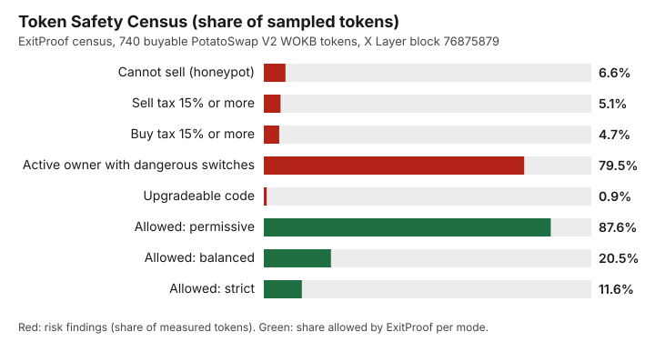

# ExitProof Token Safety Census

Snapshot: X Layer block **76868206** (2026-11-25T20:07:22.000Z). Venue: PotatoSwap V2 (factory `0x630DB8E822805c82Ca40a54daE02dd5aC31f7fcF`), WOKB pairs.
Every number below was measured by ExitProof itself: the real `ExitProofRouter.inspect()` with the real taped-out
policy circuit, run on a local anvil fork of X Layer mainnet at that block, plus the ExitProof static scanner (v4).

## Headline

- **32%** of 740 buyable live tokens are blocked by ExitProof **even in permissive mode** (cannot sell all back, or a tax of 15% or more).
- **31.1%** cannot be sold back at all (reason 1, honeypot).
- **38.4%** have an active owner holding dangerous switches (fees, blacklist, trading pause, limits): time bombs that look fine today.
- ExitProof allows **68%** in permissive, **49.6%** in balanced (default) and **11.4%** in strict mode.
- A further 60 of 800 sampled live tokens (7.5%) cannot be bought through ExitProof at all right now (50 of 58 cannot be bought by a plain wallet either: trading closed or buys disabled); they are reported apart and are not counted above.



## Summary

| metric | value |
|---|---|
| PotatoSwap pairs at snapshot | 27534 (26996 paired with WOKB) |
| skipped: WOKB reserve under 0.01 OKB (never funded, drained or rugged) | 26043 of 26996 WOKB pairs (96.5%); 1356 hold no WOKB at all |
| dust among the 600 newest WOKB pairs | 562 (93.7%) |
| live WOKB pools (the population sampled) | 953 holding 28790.56 OKB of WOKB in total |
| sample drawn from the live pools | 600 most recent + 200 random older (seed 196) |
| tokens checked | 800 |
| measured (inspect Report + scan) | 740 |
| cannot buy at all (inspect reverted) | 60 (SwapFailed 58, TooLittle 2) |
| excluded (RPC errors) | 0 |
| can't sell (reason 1) | 31.1% (230) |
| sell tax >= 15% | 0.5% (4) |
| buy tax >= 15% | 2.2% (16) |
| any sell tax >= 5% / buy tax >= 5% | 3.4% / 14.9% |
| active owner (owner() non-zero or privileged code) | 88.6% (owner() non-zero: 42.3%) |
| dangerous owner switches (active owner + dangerSetter) | 38.4% (284) |
| a listed dangerous setter selector present | 38% |
| upgradeable (proxy / live delegatecall) | 0.9% (7) |
| privileged via unknown selector (allowlist model) | 88.5% (655) |
| allowed: permissive / balanced / strict | 68% / 49.6% / 11.4% |
| allowed before the scanner attests (unscanned) | 68% / 38.2% / 0% |

All percentages use the measured (buyable) tokens as the base. Tokens that cannot be bought are listed apart:
ExitProof blocks them too (the buy reverts), but a closed or drained pool is not a honeypot.

### Cross-check with a plain wallet

Every "cannot sell" and "cannot buy" token was re-tried on the same fork without ExitProof: a fresh impersonated EOA
buys directly on the pair (as the PotatoSwap router does) and sells its whole balance back in the next block.

| ExitProof finding | checked | plain wallet agrees | plain wallet differs |
|---|---|---|---|
| cannot sell (reason 1) | 230 | 225 buy but cannot sell, 2 cannot even buy | 3 sell fine |
| cannot buy (inspect reverted) | 58 | 50 cannot buy either | 8 can buy (8 of them then cannot sell) |

Where the plain wallet differs, the token treats contracts (the router or the fresh probe holder) differently from
wallets, or the same block differently from the next one. ExitProof still blocks such buys: a token that
discriminates by caller can do the same to any holder later, so ExitProof fails closed.

### Block reasons per mode (first failing check, as the circuit reports it)

| reason | permissive | balanced | strict |
|---|---|---|---|
| 0 allowed | 503 | 367 | 84 |
| 1 cannot sell | 230 | 230 | 230 |
| 2 sell tax too high | 4 | 4 | 25 |
| 3 buy tax too high | 3 | 3 | 10 |
| 4 upgradeable | 0 | 4 | 4 |
| 5 dangerous owner powers | 0 | 132 | 113 |
| 7 owner still active | 0 | 0 | 274 |
| cannot buy (inspect reverted) | 60 | 60 | 60 |

### Recent launches vs older pairs

| group | measured | cannot buy | can't sell | blocked in permissive | allowed permissive / balanced / strict |
|---|---|---|---|---|---|
| recent | 547 | 53 (8.8%) | 37.5% | 38.8% | 61.2% / 46.3% / 14.3% |
| older | 193 | 7 (3.5%) | 13% | 13% | 87% / 59.1% / 3.1% |

## 20 most notable dangerous tokens

Ranked by severity (cannot sell > tax of 15% or more > active owner with dangerous switches > upgradeable > cannot buy), then by
WOKB liquidity in the pool. Addresses are public chain data. Facts = the 11-bit circuit input without the mode bits.

| # | token | symbol | pair | WOKB liquidity | facts | ExitProof verdict |
|---|---|---|---|---|---|---|
| 1 | `0x4D87750a795b0Ae310A24349fA9108585100A90e` | PUFF | `0xAd71E567501633f96948cd46E4700799006D3D15` | 757.2202 OKB | 0x0ae: CANNOT SELL, sell tax >=50%/unmeasurable, buy tax 5-15%, owner active, danger switches; setters: setUniswapV2Pair, setSwapAndLiquifyEnabled; cross-check: EOA buys, cannot sell | cannot sell (all modes) |
| 2 | `0xaa7EDeA4F673b0259e82628103f064E884ad3d9B` | XFROG | `0x047F755492FeaAF22b383FAf71E877Cb80EF167A` | 533.974 OKB | 0x0ae: CANNOT SELL, sell tax >=50%/unmeasurable, buy tax 5-15%, owner active, danger switches; setters: setSwapAndLiquifyEnabled; cross-check: EOA buys, cannot sell | cannot sell (all modes) |
| 3 | `0xB313D39cAf815C58129Ad67EEa451dC57c30d96e` | KINGX | `0xF6BbB32b277983f37e7Fe8ed7d2a678Da19e62b6` | 532.1624 OKB | 0x06e: CANNOT SELL, sell tax >=50%/unmeasurable, buy tax 5-15%, owner active, upgradeable; cross-check: EOA buys, cannot sell | cannot sell (all modes) |
| 4 | `0xbB173865363dAF3E7779252C329DA3F3f23736fC` | NIUB | `0xaE026018052F04358fcF87EFB45DdA6AF26aDCaE` | 431.174 OKB | 0x02e: CANNOT SELL, sell tax >=50%/unmeasurable, buy tax 5-15%, owner active; cross-check: EOA buys, cannot sell | cannot sell (all modes) |
| 5 | `0x246E5eF65D29DD6375413959c1378F7612A8b983` | DOGFART | `0x247930e5Feb2E5Db916E2d1bFB2620e86aE2e728` | 370.8563 OKB | 0x0ae: CANNOT SELL, sell tax >=50%/unmeasurable, buy tax 5-15%, owner active, danger switches; setters: setMaxWalletAmount, setMarketingFee, excludeFromFees, setSwapAndLiquifyEnabled; cross-check: EOA buys, cannot sell | cannot sell (all modes) |
| 6 | `0xf03D1b8666Ff16e3372103704Dd7f6740dc7bEbc` | OKDOG | `0xEffa6A6168C955c3211e3E89fc46AD301D4cbE10` | 229.3702 OKB | 0x026: CANNOT SELL, sell tax >=50%/unmeasurable, buy tax <5%, owner active; cross-check: EOA buys, cannot sell | cannot sell (all modes) |
| 7 | `0x4C225fb675c0c475b53381463782a7F741D59763` | OEOE | `0xDFdEB88d43970BCBfB2E6B1C531A97C2EC8aeFAF` | 131.3019 OKB | 0x0a6: CANNOT SELL, sell tax >=50%/unmeasurable, buy tax <5%, owner active, danger switches; setters: setMaxWalletAmount, setMarketingFee, excludeFromFees, setSwapAndLiquifyEnabled; cross-check: EOA buys, cannot sell | cannot sell (all modes) |
| 8 | `0x38273c0AF7EFb2d410923F3C102D446AC1D7DAaB` | CATSHIT | `0xE783788ffcDa04220aA4A8C55Db906De7C6C7345` | 119.6362 OKB | 0x0a6: CANNOT SELL, sell tax >=50%/unmeasurable, buy tax <5%, owner active, danger switches; setters: setMaxWalletAmount, setMarketingFee, excludeFromFees, setSwapAndLiquifyEnabled; cross-check: EOA buys, cannot sell | cannot sell (all modes) |
| 9 | `0x6A456d47355ff55773d2962b5eBCAC38260aE028` | XPEPE | `0x771db0425dE8135eAb28A60f3b213fF22d562E81` | 103.4436 OKB | 0x0a6: CANNOT SELL, sell tax >=50%/unmeasurable, buy tax <5%, owner active, danger switches; setters: setMaxWalletAmount, setMarketingFee, excludeFromFees, setSwapAndLiquifyEnabled; cross-check: EOA buys, cannot sell | cannot sell (all modes) |
| 10 | `0xF1110E05878B5Eb5cD62cC332e0079E8c3e6aB99` | FLAME | `0x87C7B326406a001A56a38C5bDAb573232474d274` | 85.2355 OKB | 0x0a6: CANNOT SELL, sell tax >=50%/unmeasurable, buy tax <5%, owner active, danger switches; setters: setPaused, setTradingEnabled; cross-check: EOA buys, cannot sell | cannot sell (all modes) |
| 11 | `0xA3f84Fe915D7560cCB60c5C22aB0bBAf772dF352` | Xing | `0x160085c09bA9489D912a9468C3f40F6b42edb939` | 76.1762 OKB | 0x0a6: CANNOT SELL, sell tax >=50%/unmeasurable, buy tax <5%, owner active, danger switches; setters: setSwapAndLiquifyEnabled; cross-check: EOA buys, cannot sell | cannot sell (all modes) |
| 12 | `0xA48ff5028E4141C13AfF251289A7035a55E691D4` | DOG | `0x64772582ed58355b74E14717394B6724212bBE31` | 66.3613 OKB | 0x0a6: CANNOT SELL, sell tax >=50%/unmeasurable, buy tax <5%, owner active, danger switches; setters: excludeFromFee, includeInFee; cross-check: EOA buys, cannot sell | cannot sell (all modes) |
| 13 | `0x6BB87A0318310d97F8D3dBC69531B97A39035555` | Babyokb | `0x6Da9fa7Aa44D758B14e53048E798490d4D0d7058` | 65.4991 OKB | 0x0a6: CANNOT SELL, sell tax >=50%/unmeasurable, buy tax <5%, owner active, danger switches; setters: setMaxWalletAmount, setMarketingFee, excludeFromFees, setSwapAndLiquifyEnabled; cross-check: EOA buys, cannot sell | cannot sell (all modes) |
| 14 | `0x387d9a8F8424B12B8aad2d1b7618726Ba8356789` | Potato | `0x7C121AAC27230f95F4b3f49643ca1658312ac774` | 56.2937 OKB | 0x026: CANNOT SELL, sell tax >=50%/unmeasurable, buy tax <5%, owner active; cross-check: EOA buys, cannot sell | cannot sell (all modes) |
| 15 | `0xCEd157fDc1961E8a59D57F66A30954c9B4598F50` | MubarakX  | `0xBAF2F626C292A9e3Ea3558B2Cd3e7335EB8Fb5d9` | 55.0236 OKB | 0x0a6: CANNOT SELL, sell tax >=50%/unmeasurable, buy tax <5%, owner active, danger switches; setters: setSwapAndLiquifyEnabled, setMaxTxAmount; cross-check: EOA buys, cannot sell | cannot sell (all modes) |
| 16 | `0x541683b205CB9D1D0bF4a1Acc1DE3dE634c6d0D3` | DORAE | `0xb5fbE4D87E7159d1C9042C1CC1f559e8162990F9` | 50.8395 OKB | 0x0a6: CANNOT SELL, sell tax >=50%/unmeasurable, buy tax <5%, owner active, danger switches; setters: setMaxWalletAmount; cross-check: EOA buys, cannot sell | cannot sell (all modes) |
| 17 | `0x648367A6F46b0bF727deA950990d0bd479097777` | 领头羊 | `0xF6032070523db316A8B9eDa76a7Ff1B115bA2Ba0` | 49.5002 OKB | 0x026: CANNOT SELL, sell tax >=50%/unmeasurable, buy tax <5%, owner active; cross-check: EOA buys, cannot sell | cannot sell (all modes) |
| 18 | `0xf7c868cc4FA5A7300C399c62d891e3DfCE440556` | XMONEY | `0x2caE7e73144dC884848c2DF50F6AA822314fA9F4` | 45.5724 OKB | 0x0ae: CANNOT SELL, sell tax >=50%/unmeasurable, buy tax 5-15%, owner active, danger switches; setters: setUniswapV2Pair, includeInFee; cross-check: EOA buys, cannot sell | cannot sell (all modes) |
| 19 | `0x00D60b54B02Cbc121b0C84C087df5Fbf396ee626` | WUKONG | `0x32217755c5F3bcA923A491e9c9F9A2aC68840E44` | 45.2897 OKB | 0x0a6: CANNOT SELL, sell tax >=50%/unmeasurable, buy tax <5%, owner active, danger switches; setters: setSwapAndLiquifyEnabled; cross-check: EOA buys, cannot sell | cannot sell (all modes) |
| 20 | `0x9923F9FFb322095eA46cFcd4e43Af82cfd3d853e` | RUOK | `0xEe81E04624D8AF45b6c14735b92c1513E0a1AAe8` | 43.9002 OKB | 0x0ae: CANNOT SELL, sell tax >=50%/unmeasurable, buy tax 5-15%, owner active, danger switches; setters: setSwapAndLiquifyEnabled; cross-check: EOA buys, cannot sell | cannot sell (all modes) |

## Methodology

1. **Snapshot.** A local anvil fork of X Layer mainnet (chain 196) pinned at block 76868206 (2026-11-25T20:07:22.000Z). Mainnet was only read (via a read-only, method-allowlisted proxy); every transaction went to the local fork, signed with anvil's public test key.
2. **Stack.** The repo's own `scripts/tapeout.mjs` and `scripts/deploy-fork.mjs` created the TapeOut processor, taped out the 54-NAND ExitProof policy circuit (verified on all 2048 inputs on the forked processor), and deployed `RiskRegistry` and `ExitProofRouter` on the fork.
3. **Sample.** All 27534 pairs were enumerated from the factory (`allPairs`) and the reserves of all 26996 WOKB pairs were read at the snapshot block. Pairs with less than 0.01 OKB of WOKB reserve were skipped and counted (most launch pairs on PotatoSwap are never funded or end up drained). From the 953 live pools: the 600 most recent plus 200 drawn uniformly from the older ones (mulberry32 partial Fisher-Yates, seed 196).
4. **Dynamic check.** `eth_call` of `ExitProofRouter.inspect(factory, WOKB, amountIn, token, permissive)` with amountIn = min(0.001 OKB, 1% of WOKB reserve). The router buys on the pair, hands the whole position to a freshly created holder, sells all of it back, measures buy and sell tax into buckets (<5%, 5-15%, 15-50%, >=50%), reads `owner()`, and asks the circuit. It always reverts with `Report(facts, allow, reason, buyOut, sellOut)`.
5. **Static check.** `scanner/src/scan.mjs` `scan()` on the same fork: dispatcher selectors against the safe allowlist and the dangerous-setter list, caller-vs-storage checks, external calls, proxy slots, `owner()`.
6. **Verdicts.** The facts the router would build once the scanner daemon has attested the token (registry flags = scan result: `ownerActive = owner() || privileged`, `upgradeable = scan.upgradeable`, `danger = dangerSetter`, `unscanned = 0`), evaluated for each mode with `circuit/truth.json`, the exhaustive truth table of the taped-out circuit (generated from `circuit/spec.py`). For every token the on-chain circuit answer in the Report was compared with the truth table (0 mismatches).
7. **Plain-wallet cross-check.** Every cannot-sell and cannot-buy token was re-tried without ExitProof on the same fork, serially, inside `evm_snapshot` / `evm_revert`: a fresh impersonated EOA wraps the probe amount, buys directly on the pair, waits one block and sells its whole balance back on the pair (the same V2 math the PotatoSwap router uses).
8. **Same state.** The stack deployment added 8 fork-only transactions from anvil test account #2 (block 76868206 + 1 to + 8); they touch only the new TapeOut processor, the BEM token allowances of that account and the two new contracts, never a sampled token or pair. Inspect and scan ran at the fork head after them.

**Fork simulation = what ExitProof sees.** At that block, the fork runs the same bytecode with the same state as mainnet, so each Report is exactly what `inspect()` (and the identical check inside `buyETH`) would return for a real user at that block.

## Caveats and limits

- One block. Owner-controlled tokens can change after the snapshot (that is what the time-bomb columns measure: the power to change, not the change).
- A tiny probe (at most 0.001 OKB). Tokens with max-transaction / max-wallet limits or amount-dependent taxes may behave differently at larger sizes; tax buckets on very small amounts can be distorted by rounding on low-decimal tokens.
- The probe sells from a fresh contract holder in the same transaction. Tokens that only trap EOAs or later blocks (cooldowns, time-based traps) can pass the probe; the static flags exist to cover that class, and they are heuristics with documented false positives (see `scanner/README.md`), mostly on strict mode.
- "Dangerous owner switches" means ExitProof found a listed dangerous setter, live SELFDESTRUCT or an unrecognized dispatcher, with an active owner. It is a capability, not proof of intent. The L3 owner-power simulation (`simulate()`) was not run in this census, so `ownerCanTrap` is false everywhere and the danger share is a lower bound in that respect.
- Dust pools (WOKB reserve below the threshold) are excluded from all percentages; many of them are rugged or abandoned launches, so the census describes live pools only.
- The sample is the newest pairs plus a random draw of older ones, not the full set; the recent group dominates and recent launches are riskier, so the totals are not a uniform estimate over all pairs. The per-group table separates them.

## Reproduce

```
N=600 M=200 SEED=196 node scanner/src/census.mjs   # writes docs/census-raw.jsonl (resumable)
node scanner/src/census-report.mjs                    # writes docs/CENSUS.md, docs/census.json, docs/census.svg
```

Re-running at block 76868206 needs an archive-capable upstream for the fork; a fresh run uses the latest block. Raw per-token rows: `docs/census-raw.jsonl`.
